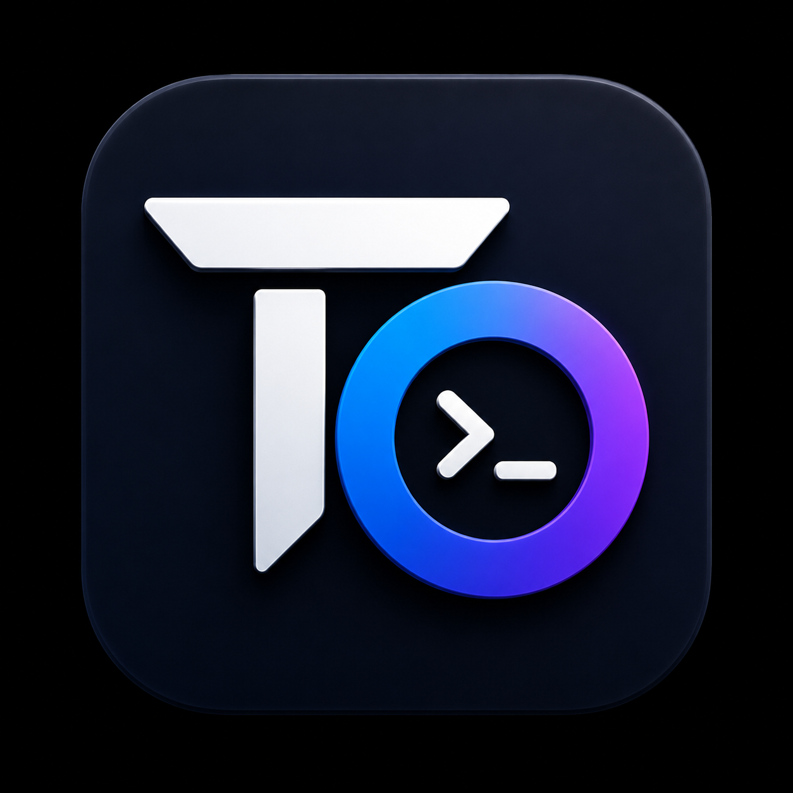
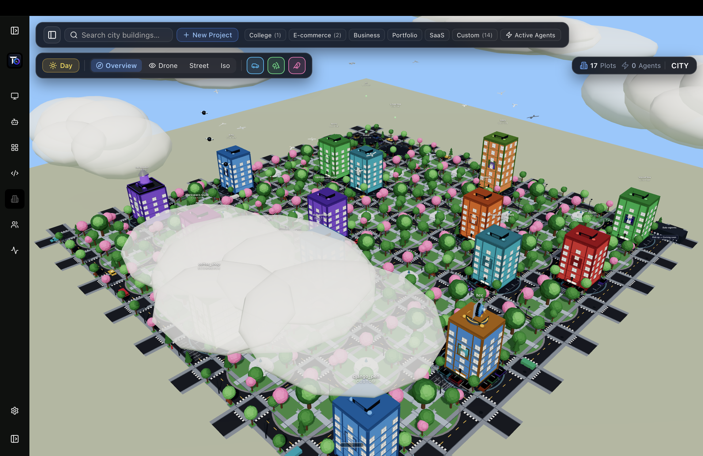

<div align="center">



# Task Orchestrator

### Terminal Task Orchestrator

**A native desktop command center for managing multiple AI agent terminals.**

[]()
[]()
[]()
[]()
[]()
[]()
[](LICENSE)
[](LICENSE-APACHE)
[](LICENSE-GPL-3.0)



</div>

---

## 📥 Download & Install

### Quick Start — Pre-built Binaries

| Platform | Download | Version |
|----------|----------|---------|
| **macOS** (Apple Silicon) | [Download .dmg](https://github.com/kennethaman0891/tto/releases/download/v2.3.1/tto_darwin_arm64.dmg) | v2.3.1 |
| **macOS** (Intel) | [Download .dmg](https://github.com/kennethaman0891/tto/releases/download/v2.3.1/tto_darwin_arm64.dmg) (Rosetta) | v2.3.1 |
| **Windows** | [Download .exe](https://github.com/kennethaman0891/tto/releases) (CI build) | v2.3.1 |

> **Note:** This is a **private repository**. Pre-built binaries are available for authorized users only. 
> Requires the Python sidecar to be running. See [Installation](#installation) for details.

### From Source

#### macOS / Linux

```bash
# Clone the repository
git clone https://github.com/kennethaman0891/tto.git
cd tto

# Install Rust (if not installed)
curl --proto '=https' --tlsv1.2 -sSf https://sh.rustup.rs | sh

# Install Node.js dependencies
cd frontend && npm install && cd ..

# Install Python dependencies
pip install fastapi uvicorn[standard] pydantic aiohttp websockets psutil

# Run the backend sidecar
python backend/main.py

# In another terminal, build and run the desktop app
cd frontend/src-tauri && npx tauri dev
```

#### Windows

```powershell
# Clone the repository
git clone https://github.com/kennethaman0891/tto.git
cd tto

# Install Rust via rustup
Invoke-WebRequest -Uri https://win.rustup.rs/x86_64 -OutFile rustup-init.exe
.
ustup-init.exe

# Install Node.js dependencies
cd frontend
npm install
cd ..

# Install Python dependencies
pip install fastapi uvicorn[standard] pydantic aiohttp websockets psutil

# Run the backend sidecar
python backend/main.py

# Build and run the desktop app
cd frontend\src-tauri
npx tauri dev
```

### Running the Application

Once built and the sidecar is running:

```bash
# Method 1: Using Tauri dev mode
cd frontend/src-tauri
npx tauri dev

# Method 2: Running the built app (macOS)
open /Applications/Task Orchestrator.app

# Method 3: Running the built app (Windows)
& "C:\Program Files	to	to.exe"
```

---


---


## 🔥 What is Task Orchestrator?

Task Orchestrator solves **one painful problem**: you have 30+ terminals open, each running an AI coding agent (opencode, Claude Code, Codex, Gemini CLI), and you can't remember which terminal is doing what.

It gives you a **single native desktop window** that brings order to the chaos:

<div align="center">

| Feature | Description |
|---------|-------------|
| 🖥️ **Real PTY Terminals** | Actual macOS Terminal windows — no tmux, no browser tricks, full TUI support |
| 🤖 **AI Agent Orchestration** | Type one goal → splits into sub-tasks → dispatched to your terminals in parallel |
| 📊 **Token Usage Dashboard** | Tracks tokens per model across all sessions in real-time |
| 📁 **File Browser + Editor** | Built-in CodeMirror 6 editor with minimap, lint gutter, multi-tab support |
| 💬 **Remote Control** | Control everything from WhatsApp or Telegram bots |
| 🔒 **Safe by Design** | Shell injection prevention, path containment, CORS lockdown |

</div>

---

## 🏗️ Architecture

```
┌─────────────────────────────────────────────────────────────────┐
│                       Task Orchestrator Desktop App                           │
│                                                                 │
│   ┌──────────────────┐    ┌──────────────┐    ┌─────────────┐  │
│   │  Terminal        │    │  Code        │    │  Workspace  │  │
│   │  Workspace       │◄──►│  Editor      │◄──►│  Control    │  │
│   │  (xterm.js)      │    │  (CM6)       │    │  Panel      │  │
│   └────────┬─────────┘    └──────────────┘    └──────┬──────┘  │
│            │                                          │         │
│   ┌────────┴──────────────────────────────────────────┴──────┐  │
│   │          Rust PTY Engine (Tauri 2 + portable-pty)        │  │
│   │         Real OS-level terminal sessions (no emulators)   │  │
│   └──────────────────────────────┬───────────────────────────┘  │
└──────────────────────────────────┼───────────────────────────────┘
                                   │ HTTP + WebSocket
┌──────────────────────────────────┴───────────────────────────────┐
│              Python FastAPI Sidecar (port 8765)                   │
│                                                                    │
│  • Session discovery & management via osascript / lsof / tmux    │
│  • Task lifecycle (create → assign → running → done)             │
│  • Token usage tracking (reads opencode.db directly)             │
│  • File browser & code editor REST API                           │
│  • Git branch status auto-refresh                                │
│  • Remote control (WhatsApp via OpenWA / Telegram bot)           │
│  • AI-powered task suggestions                                   │
│  • Orchestrator engine (split goals → parallel dispatch)         │
└────────────────────────────────────────────────────────────────────┘
```

### Tech Stack

| Layer | Technology |
|-------|-----------|
| Desktop shell | [Tauri 2](https://tauri.app/) (Rust) |
| Terminal engine | [portable-pty](https://crates.io/crates/portable-pty) (Rust) |
| Frontend | React 19 + Vite 6 + TypeScript |
| Terminal rendering | xterm.js 6 |
| Code editor | CodeMirror 6 (minimap, lint, search) |
| Backend | Python 3.11+ / FastAPI / Uvicorn |
| State | JSON file (`~/.tto-web/state.json`) |
| Styling | Hand-written CSS (dark theme + 7 built-in themes) |
| CI/CD | GitHub Actions (macOS, Windows builds) |

---

## ✨ Features

### Multi-Terminal Workspace

- **Real PTY sessions** — not emulated. Your actual login shell with full TUI support.
- **Persistent panes** — switch tabs without losing scrollback or killing processes.
- **TUI auto-expand** — opencode, Claude Code, and other TUI apps get full-workspace canvas automatically.
- **Clickable file links** — click `file.py:42` in terminal output to open it in the editor.

### Code Editor

- **CodeMirror 6** with syntax highlighting for 50+ languages.
- **Minimap**, breadcrumb navigation, and auto-save toggle.
- **Lint gutter** for real-time diagnostics.
- **Multi-tab** — open multiple files with a VS Code-like tab bar.

### Command Palette

- Press `Cmd+P` to fuzzy-search all files in your workspace.
- Recent files, recursive search, keyboard navigation.

### File Browser

- Navigate your project tree with the sidebar file explorer.
- Right-click context menu: **create**, **rename**, **delete** files and folders.
- Inline rename on double-click.
- Drag-and-drop upload from Finder.

### Workspace Control Panel

- **Terminal list** with live status (running, exited, agent, model).
- **View modes**: Focus (single terminal), Split (terminal + editor), Grid (card overview).
- **Token usage** dashboard with per-model breakdown.

### Orchestrator (Kanban View)

- Type one high-level goal.
- The orchestrator splits it into sub-tasks and dispatches them to your terminals.
- Live split cards update as agents work.

### Git Integration

- Branch name and dirty file count in the status bar.
- Auto-refreshes every 30 seconds.

### Remote Control (Optional)

- Control Task Orchestrator from **WhatsApp** (via OpenWA) or **Telegram**.
- Send terminal commands, check status, get task notifications.
- All remote vars are optional — Task Orchestrator works perfectly with nothing set.

---

## 🚀 Quick Start

### Prerequisites

- **macOS** (ARM64 or x86_64) or **Windows** (x64)
- [Node.js](https://nodejs.org/) v18+
- [Rust](https://www.rust-lang.org/tools/install) (via rustup)
- [Python](https://www.python.org/) 3.11+
- Xcode Command Line Tools (macOS): `xcode-select --install`

### Install Dependencies

```bash
# Frontend
cd frontend && npm install && cd ..

# Backend
python3 -m venv venv
source venv/bin/activate
pip install fastapi uvicorn[standard] pydantic aiohttp websockets psutil
```

### Run in Development

```bash
# Terminal 1: Start the backend sidecar
cd backend && python3 main.py

# Terminal 2: Start the Tauri dev server
cd frontend && npm run tauri:dev
```

### Build for Production

```bash
cd frontend
npx tauri build
```

Output:
- **macOS**: `target/release/bundle/macos/Task Orchestrator.app` + `target/release/bundle/dmg/tto_0.1.0_aarch64.dmg`
- **Windows**: `target\release\bundle\msi\tto_0.1.0_x64-setup.exe`

> **Important:** Always use `npx tauri build` (not `cargo build`) to ensure frontend assets are embedded into the binary.

---

## 📁 Project Structure

```
tto-web/
├── frontend/                     # React + Vite + Tauri desktop app
│   ├── src/
│   │   ├── App.tsx               # Main app layout & state management
│   │   ├── components/           # 27 React components
│   │   │   ├── TerminalWorkspace   # Terminal viewport (left panel)
│   │   │   ├── CodeEditor          # CodeMirror 6 editor with minimap
│   │   │   ├── CommandPalette      # Cmd+P fuzzy file search
│   │   │   ├── FileBrowser         # Sidebar file explorer
│   │   │   ├── SplitView           # Resizable split panels
│   │   │   ├── GitStatusBadge      # Branch + dirty count
│   │   │   ├── KanbanBoard         # Orchestrator board
│   │   │   ├── WorkspaceBar        # Top toolbar & view switcher
│   │   │   └── ...                 # StatsBar, TokenUsage, Toast, etc.
│   │   ├── terminal/             # Terminal engine (xterm.js, PTY bridge)
│   │   ├── api/                  # Backend API client
│   │   ├── hooks/                # React hooks (useTerminals, etc.)
│   │   ├── styles.css            # Hand-written CSS (dark theme, 7 themes)
│   │   └── workspace.ts          # Workspace state & responsive grid
│   ├── src-tauri/                # Rust Tauri 2 engine
│   │   ├── src/
│   │   │   ├── lib.rs            # App setup, sidecar lifecycle
│   │   │   ├── ipc.rs            # Tauri commands (terminal CRUD)
│   │   │   ├── sidecar.rs        # Python backend auto-launcher
│   │   │   ├── relay.rs          # Command relay (backend → PTY)
│   │   │   └── terminal/         # PTY manager, scheduler, render
│   │   └── Cargo.toml
│   └── tauri.conf.json           # Tauri configuration
│
├── backend/                      # Python FastAPI sidecar
│   ├── main.py                   # API server (port 8765)
│   ├── file_watcher.py           # File system change monitoring
│   └── remote/                   # Remote control layer
│       ├── telegram.py           # Telegram bot transport
│       ├── openwa_client.py      # WhatsApp via OpenWA
│       ├── safety.py             # Command classification & blocking
│       ├── parser.py             # Natural language command parser
│       └── service.py            # Command execution engine
│
├── agent/                        # WebSocket agent (optional)
├── scripts/                      # Utility scripts
├── build-scripts/                # Platform-specific build helpers
│   ├── build-windows.bat         # Windows build script
│   └── build-windows.sh          # Linux/WSL build script
├── .github/workflows/            # CI/CD (macOS, Windows, universal)
├── AUDIT_REPORT.md               # Comprehensive codebase audit
├── WINDOWS_AUDIT.md              # Windows compatibility audit
├── BUILD.md                      # Detailed build guide
├── INSTRUCTION_GUIDE.md          # Usage documentation
└── SECURITY_REVIEW.md            # Security audit & remediation log
```

---

## 🔌 API Endpoints

The FastAPI sidecar runs on `http://localhost:8765` and exposes:

| Method | Endpoint | Description |
|--------|----------|-------------|
| GET | `/api/health` | Server health check |
| GET | `/api/terminals` | List all active terminal sessions |
| GET | `/api/files?path=` | Browse filesystem |
| GET | `/api/file?path=` | Read file content |
| PUT | `/api/file` | Write/update file |
| POST | `/api/file/create` | Create new file |
| POST | `/api/file/rename` | Rename or move file |
| DELETE | `/api/file/delete?path=` | Delete file or directory |
| POST | `/api/dir/create` | Create directory (recursive) |
| GET | `/api/git/status?path=` | Git branch + changed files |
| GET | `/api/git/branch?path=` | Current git branch name |
| POST | `/api/task` | Create or update task |
| GET | `/api/tasks?tty=` | List tasks for a session |
| GET | `/api/token-usage` | Token usage across sessions |
| WS | `/ws/terminal/{tty}` | Real-time terminal I/O stream |
| WS | `/ws/command-relay` | Backend → PTY command relay |
| POST | `/api/orchestrator/run` | Dispatch orchestrator run |
| GET | `/api/orchestrator/runs` | List orchestrator runs |
| POST | `/api/project/upload` | Upload project archive |

---

## 🔄 CI/CD

GitHub Actions workflows automate builds for all platforms:

| Workflow | Trigger | Output |
|----------|---------|--------|
| `build-macos.yml` | Push to `main` | macOS `.app` + `.dmg` |
| `build-windows.yml` | Push to `main` | Windows `.msi` + `.exe` |

### Building on Windows

Windows builds must run on a Windows machine (or CI). Cross-compilation from macOS is not supported due to Windows SDK requirements.

---

## ⚙️ Configuration

All configuration is via environment variables. See [`.env.example`](.env.example) for the full list.

| Variable | Default | Description |
|----------|---------|-------------|
| `Task Orchestrator_REMOTE_ENABLED` | `false` | Enable remote control subsystem |
| `OPENWA_ENABLED` | `false` | Enable WhatsApp transport |
| `Task Orchestrator_TELEGRAM_ENABLED` | `false` | Enable Telegram bot transport |
| `OPENWA_BASE_URL` | `http://127.0.0.1:2785` | OpenWA service URL |
| `OPENWA_API_KEY` | — | OpenWA authentication key |
| `TELEGRAM_BOT_TOKEN` | — | Telegram bot token from @BotFather |
| `Task Orchestrator_REMOTE_RATE_LIMIT` | `30` | Max commands per sender per minute |

---

## Colab visits

Invited people can sign in from your network, or from an optional HTTPS public link. Colab Hub keeps one record per visit (who, where from, how long, and a timeline of what they did) and can export it to CSV, a printable report, or PDF. The owner guide is [docs/collab-hub.md](docs/collab-hub.md).

## 🔒 Security

Task Orchestrator executes shell commands by design — that's the product. Security measures focus on **containing** that power:

- **CORS lockdown** — localhost/Tauri allowlist only (no `*`)
- **WebSocket Origin guards** — rejects cross-origin socket connections
- **Shell injection prevention** — all user input is validated and `shlex.quote()`-d
- **Path containment** — file operations restricted to `$HOME` with symlink resolution
- **Remote command classifier** — chain-aware safety analysis (BLOCKS `rm -rf`, `eval`, pipe-to-shell)

See [SECURITY_REVIEW.md](SECURITY_REVIEW.md) for the full audit.

---

## 🎨 Themes

7 built-in themes, switchable at runtime:

| Theme | Style |
|-------|-------|
| **Void** | Pure dark (default) |
| **Neon Tokyo** | Cyberpunk neon accents |
| **Synthwave** | Retro purple/pink |
| **Dracula** | Classic Dracula palette |
| **Carbon** | IBM Carbon dark |
| **Obsidian** | Deep blue-black |
| **Paper** | Light theme |

All themes use CSS custom properties — change one value to restyle the entire app.

---

## 📚 Documentation

- [BUILD.md](BUILD.md) — Build guide for macOS and Windows
- [INSTRUCTION_GUIDE.md](INSTRUCTION_GUIDE.md) — Comprehensive usage documentation
- [SECURITY_REVIEW.md](SECURITY_REVIEW.md) — Security audit and remediation log
- [AUDIT_REPORT.md](AUDIT_REPORT.md) — Full codebase audit (81 findings)
- [WINDOWS_AUDIT.md](WINDOWS_AUDIT.md) — Windows compatibility report

---

## 🤝 Contributing

Contributions welcome! Please read [AUDIT_REPORT.md](AUDIT_REPORT.md) for known issues and priorities.

---

## 📄 License

Tri-licensed under the **MIT License**, the **Apache License 2.0**, and the
**GNU General Public License v3.0** — you may use this software under any of
these licenses, at your option.

- MIT License: see [LICENSE](LICENSE)
- Apache License 2.0: see [LICENSE-APACHE](LICENSE-APACHE)
- GNU GPL v3.0: see [LICENSE-GPL-3.0](LICENSE-GPL-3.0)

---

<div align="center">

**Built by [kennethaman0891](https://github.com/kennethaman0891)**

*Stop tabbing between 30 terminals. Start orchestrating.*

</div>
